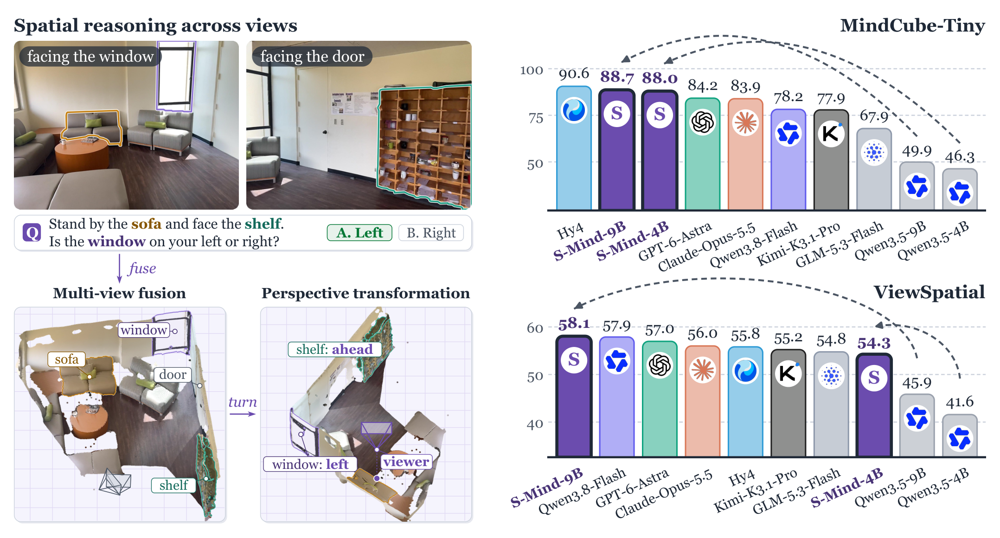
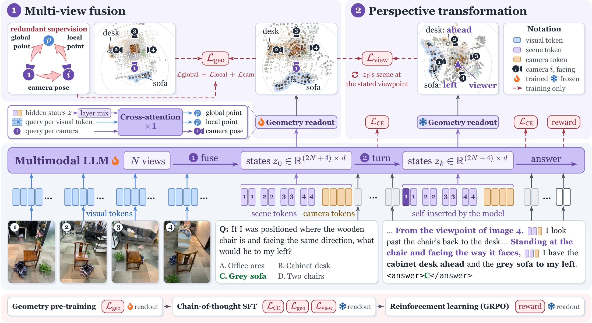

<div align="center">


**Internalizing Multi-View Geometry for Spatial Intelligence**

[](https://arxiv.org/abs/2611.28649)
[](https://kanaboon1.github.io/S-Mind/)
[](https://huggingface.co/KANABOON1/S-Mind)
[](https://paperswithcode.co/api/v1/papers/2611.28649/leaderboard-badge-link?eval=50870)

</div>

## 👋 What is S-Mind?

Two snapshots of a room, one facing the window and one facing the door, are enough for a person to walk through it in
the mind: stand by the sofa, face the shelf, and the window is on the left. Behind this lie two operations:
***assembling the views into one scene***, and ***turning that scene to a new standpoint***.

<div align="center">

</div>

Spatial fine-tuning raises the answer accuracy of multimodal LLMs, but their hidden states tell a different story: each
view is encoded well, yet the views are barely fused into one scene, and the scene stays anchored to the camera when the
reasoning moves to a new viewpoint.

**S-Mind builds both operations into the model.**

- **Multi-view fusion.** A compact set of spatial tokens after the images consolidates the views into one 3D scene,
  z<sub>0</sub>, holding the geometry each image observes and the pose of each camera in a shared frame.
- **Perspective transformation.** Whenever the reasoning shifts to a new viewpoint, the model re-emits the spatial
  tokens, and their states z<sub>k</sub> hold the same scene re-expressed from that viewpoint.

A light readout decodes every z into 3D points and cameras, so the scene the model holds can be seen at each step of its
reasoning.

<div align="center">

</div>

### ✨ Highlights

- **Accuracy.** Up to 74.03% average accuracy over four spatial reasoning benchmarks, on par with frontier general
  models such as GPT-6-Astra.
- **An internal scene.** Probing the backbone of S-Mind-4B recovers 65.11% of the cross-view 3D points, against 11.23%
  for Qwen3.5-4B, and locates points relative to a stated viewpoint with 82.17% accuracy, against 32.40%.
- **No tools.** S-Mind answers in a single generation, with no 3D reconstruction or tool calls at inference.

---

## 🤗 Checkpoints and Dataset

<table>
  <tr><th>Model</th><th>Backbone</th><th>Stage</th><th>Checkpoint</th></tr>
  <tr><td rowspan="3"><b>S-Mind-4B</b></td><td rowspan="3">Qwen3.5-4B</td><td align="center">Fusion</td><td><a href="https://huggingface.co/KANABOON1/S-Mind/tree/main/qwen3.5-4b/fusion"><code>qwen3.5-4b/fusion</code></a></td></tr>
  <tr><td align="center">SFT</td><td><a href="https://huggingface.co/KANABOON1/S-Mind/tree/main/qwen3.5-4b/sft"><code>qwen3.5-4b/sft</code></a></td></tr>
  <tr><td align="center">RL</td><td><a href="https://huggingface.co/KANABOON1/S-Mind/tree/main/qwen3.5-4b/rl"><code>qwen3.5-4b/rl</code></a></td></tr>
  <tr><td rowspan="3"><b>S-Mind-9B</b></td><td rowspan="3">Qwen3.5-9B</td><td align="center">Fusion</td><td><a href="https://huggingface.co/KANABOON1/S-Mind/tree/main/qwen3.5-9b/fusion"><code>qwen3.5-9b/fusion</code></a></td></tr>
  <tr><td align="center">SFT</td><td><a href="https://huggingface.co/KANABOON1/S-Mind/tree/main/qwen3.5-9b/sft"><code>qwen3.5-9b/sft</code></a></td></tr>
  <tr><td align="center">RL</td><td><a href="https://huggingface.co/KANABOON1/S-Mind/tree/main/qwen3.5-9b/rl"><code>qwen3.5-9b/rl</code></a></td></tr>
</table>

<table>
  <tr><th>Dataset</th><th>Contents</th><th>Download</th></tr>
  <tr><td><b>S-Mind-Data</b></td><td>reasoning chains for the SFT stage</td><td><a href="https://huggingface.co/datasets/KANABOON1/S-Mind-Data"><code>KANABOON1/S-Mind-Data</code></a></td></tr>
</table>

## 🛠️ Setup

### Environment

With Python 3.12 and NVIDIA GPUs (our runs used H100 80 GB), one script installs PyTorch 2.11 and vLLM 0.24 (CUDA 12.9
builds), S-Mind with its dependencies, the code of VGGT, MindCube and SPAR under `third_party/`, and the VGGT weights:

```bash
bash scripts/setup.sh
```

### Data

**Evaluation.** The four benchmarks:

```bash
bash scripts/data/benchmarks.sh
```

**Training.** The geometry supervision, built from ScanNet, and the SFT dataset. Request
[ScanNet](https://github.com/ScanNet/ScanNet#scannet-data) access, unzip its `scannet_frames_25k` into
`data/raw/ScanNet/frames_25k/`, and pass the download URL you receive with access:

```bash
SCANNET_URL=<ScanNet download URL> bash scripts/data/geometry.sh
bash scripts/data/sft.sh
```

## 📊 Evaluation

With any checkpoint `qwen3.5-{4b,9b}/{sft,rl}`:

```bash
CKPT=qwen3.5-4b/rl bash scripts/eval.sh
```

It downloads the checkpoint into `models/S-Mind/` and writes `<bench>/predictions.jsonl` and `<bench>/summary.json`
to `runs/eval/qwen3.5-4b-rl/` for MindCube-Tiny, SPAR-Bench (R&V), BLINK (Spatial) and ViewSpatial.

## 🔥 Training

Training has two stages: **fusion**, the paper's geometry pre-training followed by a refit of the readout, and
**perspective**, the paper's SFT. Each reads its settings from `configs/`, and options after the command are passed to
its trainer (`smind.train.fusion`, `smind.train.perspective`). Every stage writes its model to `$OUT/ckpt` and its log
to `$OUT/train.log`. The commands below train S-Mind-4B; for S-Mind-9B, add `MODEL=Qwen/Qwen3.5-9B` to the first.

**1. Fusion:** geometry pre-training of the spatial tokens, then a refit of the readout

```bash
OUT=runs/fusion GPUS=0,1 bash scripts/train/fusion.sh
```

**2. Perspective:** SFT with the geometry and view losses

```bash
FUSION=runs/fusion/ckpt OUT=runs/perspective GPUS=0,1 bash scripts/train/perspective.sh
```

## 🔬 Analyses and examples

| | |
|---|---|
| [`analysis/notebooks/`](analysis/notebooks/README.md) | reproduce the analyses of S-Mind and its base model from the released checkpoints |
| [`examples/spatial_tokens/`](examples/spatial_tokens/README.md) | decode the spatial tokens of an answer into 3D points, with an interactive viewer |

## 🫡 Citation

If you find S-Mind useful, please cite:

```bibtex
@article{fu2026smind,
  title   = {{S-Mind}: Internalizing Multi-View Geometry for Spatial Intelligence},
  author  = {Fu, Muxin and Yu, Peike and Zhang, Guibin and Zhou, Wenrui and Liu, Runze and Feng, Lang and
             Yang, Fuchao and Chen, Feng and Li, Yixuan and Zhang, Mengao and Zhang, Shiying and Shen, Wen and
             Pan, Ling and Yan, Shuicheng and An, Bo},
  journal = {arXiv preprint arXiv:2611.28649},
  year    = {2026}
}
```

## 🙏 Acknowledgements

We express our sincere gratitude to the authors of [S-Space](https://github.com/MirroS-Lab/S-Space) for generously
open-sourcing their code, which laid the foundation for our diagnostics in `analysis/diagnosis/sspace/`.

## 📄 License

Released under the [Apache License 2.0](LICENSE).
